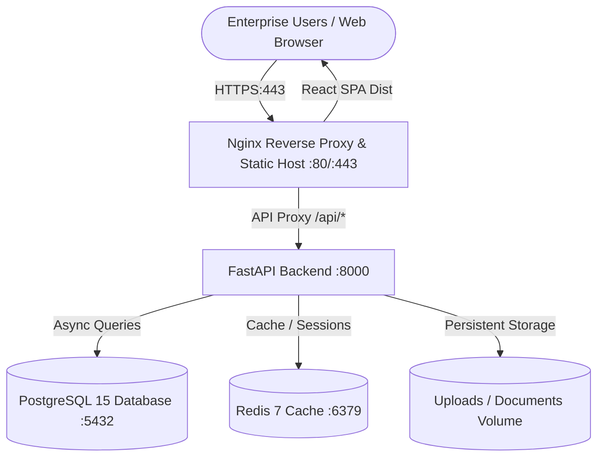

# 🚀 Production Deployment Guide
## Expert Decision Replay Platform (Enterprise Edition)

This guide provides end-to-end instructions for deploying the **Expert Decision Replay Platform** into production environments using Docker, Docker Compose, Kubernetes, or standalone systemd services.

---

## 📋 Table of Contents
1. [Architecture Overview](#-architecture-overview)
2. [Prerequisites & System Requirements](#-prerequisites--system-requirements)
3. [Quickstart: 1-Click Docker Compose Deployment](#-quickstart-1-click-docker-compose-deployment)
4. [Environment Configuration Reference](#-environment-configuration-reference)
5. [Database Setup & Management (PostgreSQL)](#-database-setup--management-postgresql)
6. [Redis Caching Setup](#-redis-caching-setup)
7. [Reverse Proxy & SSL/TLS Termination (Nginx)](#-reverse-proxy--ssltls-termination-nginx)
8. [Production Health Checks & Monitoring](#-production-health-checks--monitoring)
9. [Backup, Restore & Disaster Recovery](#-backup-restore--disaster-recovery)
10. [Troubleshooting & Maintenance](#-troubleshooting--maintenance)

---

## 🏗️ Architecture Overview

The platform uses a decoupled micro-service topology engineered for high availability and low latency:



### Components
- **Frontend Container**: Multi-stage build (Node 20 -> Nginx Alpine) serving React 18, Vite-optimized production bundle, client-side SPA router, and reverse-proxying `/api/` traffic.
- **Backend Container**: High-performance Python 3.10 ASGI server running FastAPI and Uvicorn with auto-seeding database initialization and non-root Linux user.
- **Database**: PostgreSQL 15 with persistent named volumes and healthcheck probes.
- **Cache**: Redis 7 Alpine for high-speed in-memory caching and session synchronization.
- **Storage**: Docker named volume `backend_uploads` for PDF reports, architecture drawings, and attachments.

---

## 💻 Prerequisites & System Requirements

### Hardware Requirements
| Resource | Minimum | Recommended (Enterprise Production) |
|---|---|---|
| CPU | 2 Cores | 4 - 8 Cores |
| RAM | 4 GB | 16 GB |
| Disk Storage | 20 GB SSD | 100+ GB NVMe SSD |
| Network | 100 Mbps | 1 Gbps |

### Software Prerequisites
- **Docker Engine** >= 24.0.0
- **Docker Compose** >= v2.20.0
- **Git** >= 2.30.0

---

## ⚡ Quickstart: 1-Click Docker Compose Deployment

### Step 1: Clone the Repository
```bash
git clone https://github.com/springboardmentor873-a11y/Expert-Decision-Replay-Platform.git
cd Expert-Decision-Replay-Platform
```

### Step 2: Configure Environment Variables
Copy the production environment template:
```bash
cp .env.example .env
```
Edit `.env` and set your secure `SECRET_KEY` and database credentials:
```ini
ENVIRONMENT=production
SECRET_KEY=enter_your_super_secret_production_key_here_at_least_32_chars
POSTGRES_USER=postgres
POSTGRES_PASSWORD=your_secure_password
POSTGRES_DB=expert_decision_replay
```

### Step 3: Launch Containers
Run the unified multi-container stack:
```bash
docker compose up -d --build
```

### Step 4: Verify Running Services
```bash
docker compose ps
```
All four services should display `healthy` or `running`:
```text
NAME             IMAGE                             STATUS                   PORTS
edrp-postgres    postgres:15-alpine                Up (healthy)             0.0.0.0:5432->5432/tcp
edrp-redis       redis:7-alpine                    Up (healthy)             0.0.0.0:6379->6379/tcp
edrp-backend     expert-decision-replay-backend    Up (healthy)             0.0.0.0:8000->8000/tcp
edrp-frontend    expert-decision-replay-frontend   Up                       0.0.0.0:80->80/tcp, 0.0.0.0:5173->80/tcp
```

### Step 5: Access the Platform
- **Web Dashboard**: `http://localhost` (or `http://localhost:5173`)
- **FastAPI OpenAPI Docs**: `http://localhost:8000/docs`
- **Health Endpoint**: `http://localhost:8000/health`

---

## ⚙️ Environment Configuration Reference

| Variable | Default Value | Description |
|---|---|---|
| `ENVIRONMENT` | `production` | Deployment environment flag (`production`, `staging`, `development`) |
| `POSTGRES_USER` | `postgres` | Database administrator username |
| `POSTGRES_PASSWORD` | `postgres` | Secure database administrator password |
| `POSTGRES_DB` | `expert_decision_replay` | Target database catalog name |
| `POSTGRES_PORT` | `5432` | Host port mapped to PostgreSQL |
| `DATABASE_URL` | `postgresql://...` | Connection URI formatted for SQLAlchemy |
| `REDIS_PORT` | `6379` | Host port mapped to Redis |
| `REDIS_URL` | `redis://redis:6379/0` | Connection URI for Redis in container network |
| `SECRET_KEY` | *(Required)* | High-entropy secret key for HMAC-SHA256 JWT signatures |
| `ACCESS_TOKEN_EXPIRE_MINUTES`| `1440` (24h) | JWT session token validity lifespan in minutes |
| `BACKEND_PORT` | `8000` | Host port mapped to FastAPI Uvicorn |
| `FRONTEND_PORT` | `80` | Host port mapped to Nginx web frontend |
| `VITE_API_BASE` | `http://localhost:8000` | Public backend API URL resolved by browser client |

---

## 🗄️ Database Setup & Management (PostgreSQL)

### Automatic Database Initialization
Upon startup, the FastAPI backend automatically checks schema definitions via SQLAlchemy declarative metadata and triggers `seed_data.py` to populate initial enterprise roles, sample teams, demo users, and mock decisions if tables are unseeded.

### Manual Database Migrations
To connect directly into the running PostgreSQL container:
```bash
docker compose exec postgres psql -U postgres -d expert_decision_replay
```

Useful commands:
```sql
-- Check total decisions
SELECT count(*) FROM decisions;

-- Inspect audit trail
SELECT id, action_category, action, created_at FROM audit_logs ORDER BY id DESC LIMIT 10;

-- List active roles
SELECT id, name, description FROM roles;
```

---

## 🔒 Reverse Proxy & SSL/TLS Termination (Nginx)

For enterprise HTTPS termination, place Certbot / Let's Encrypt certificates on the host or mount them into Nginx.

### Example Production SSL Virtual Host (`/etc/nginx/sites-available/edrp.conf`):
```nginx
server {
    listen 80;
    server_name decision-replay.company.com;
    return 301 https://$host$request_uri;
}

server {
    listen 443 ssl http2;
    server_name decision-replay.company.com;

    ssl_certificate /etc/letsencrypt/live/decision-replay.company.com/fullchain.pem;
    ssl_certificate_key /etc/letsencrypt/live/decision-replay.company.com/privkey.pem;
    ssl_protocols TLSv1.2 TLSv1.3;
    ssl_ciphers HIGH:!aNULL:!MD5;

    location / {
        proxy_pass http://127.0.0.1:80;
        proxy_set_header Host $host;
        proxy_set_header X-Real-IP $remote_addr;
        proxy_set_header X-Forwarded-Proto https;
    }

    location /api/ {
        proxy_pass http://127.0.0.1:8000/;
        proxy_set_header Host $host;
        proxy_set_header X-Real-IP $remote_addr;
        proxy_set_header X-Forwarded-Proto https;
    }
}
```

---

## 🩺 Production Health Checks & Monitoring

The backend exposes an automated diagnostic probe endpoint:
```bash
curl -i http://localhost:8000/health
```

### Healthy Response (HTTP 200)
```json
{
  "status": "healthy",
  "database": "connected",
  "timestamp": "2026-10-11T15:20:00.000000",
  "environment": "production"
}
```

### Unhealthy Response (HTTP 503)
If the database connection is interrupted:
```json
{
  "status": "unhealthy",
  "database": "disconnected",
  "error": "could not connect to server",
  "timestamp": "2026-10-11T15:20:00.000000"
}
```

Docker Compose and container orchestration engines (Kubernetes, AWS ECS) use this to automatically restart or divert traffic from unhealthy replicas.

---

## 💾 Backup, Restore & Disaster Recovery

### Database Backup (Logical Dump)
Execute an automated snapshot of the PostgreSQL database:
```bash
docker compose exec -t postgres pg_dump -U postgres expert_decision_replay > backup_$(date +%Y%m%d_%H%M%S).sql
```

### Document Uploads Backup
Archive persistent document attachments:
```bash
docker run --rm -v edrp_backend_uploads:/uploads -v $(pwd):/backup alpine tar -czf /backup/uploads_backup_$(date +%Y%m%d).tar.gz -C / uploads
```

### Database Restoration
To restore a snapshot into a new database container:
```bash
cat backup_file.sql | docker compose exec -T postgres psql -U postgres -d expert_decision_replay
```

---

## 🔧 Troubleshooting & Maintenance

### Viewing Real-Time Logs
```bash
# View all container logs
docker compose logs -f

# View backend logs only
docker compose logs -f backend

# View database logs only
docker compose logs -f postgres
```

### Stopping and Cleaning Up Containers
```bash
# Stop containers without removing data
docker compose stop

# Stop and remove containers (preserves database volumes)
docker compose down

# Full wipe (WARNING: deletes all persistent database records)
docker compose down -v
```

### Running Automated Test Verification Inside Containers
```bash
docker compose exec backend python run_all_tests.py
```
All milestone suites will execute and report 100% pass verification.
