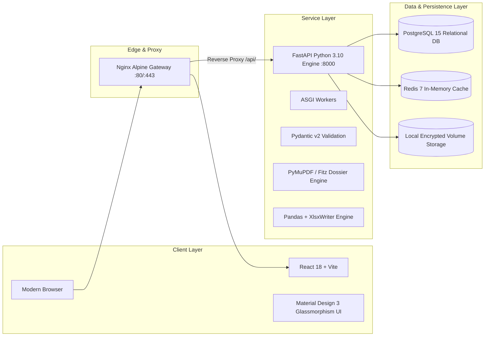
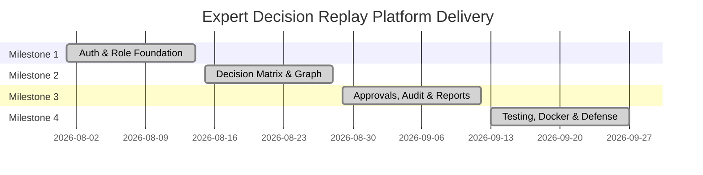

# 🎓 Final Presentation Deck & Project Defense
## Expert Decision Replay Platform
### Enterprise Decision Intelligence Platform for Knowledge Graphs and Outcome Analysis

**Course / Project:** Enterprise Decision Intelligence Platform  
**Milestone:** Milestone 4 (Final Presentation, Docker Deployment, Testing & Documentation)  
**Presented by:** Engineering Team  

---

## 📽️ Slide 1: Title & Executive Overview
- **Project Title:** Expert Decision Replay Platform (EDRP)
- **Tagline:** Preserving Institutional Knowledge & Eliminating Repeated Mistakes Through Structured Decision Replay
- **Key Proposition:** Organizations lose millions repeating past architectural and strategic mistakes because decisions are buried in forgotten chat threads or departure turnover. EDRP provides an immutable, replayable system of record for all high-stakes enterprise decisions.

---

## 📽️ Slide 2: The Core Problem Statement
- **Institutional Amnesia:** When key engineers or executives leave, the *rationale* behind technical architecture and trade-offs leaves with them.
- **Fragmented Context:** Problem statements live in Jira, evaluations live in Confluence, debates happen in Slack, and executive sign-offs happen in email.
- **Cost of Repeated Failures:** Without searchable historical precedent, teams repeat failed vendor evaluations, sub-optimal cloud architectures, and rejected designs.
- **Lack of Governance & Traceability:** Audits struggle to demonstrate who authorized high-risk architecture pivots, what alternatives were considered, and why options were eliminated.

---

## 📽️ Slide 3: Platform Architecture & Technology Stack


- **Frontend:** React 18, Vite, Material Design 3 tokens, SVG Knowledge Graph visualizer.
- **Backend:** Python 3.10, FastAPI, Uvicorn ASGI, SQLAlchemy ORM, Pydantic v2 schemas.
- **Document & Reporting:** PyMuPDF (`fitz`) for PDF dossiers, `pandas` & `xlsxwriter` for formatted multi-sheet workbooks.
- **DevOps:** Docker, Docker Compose, Nginx reverse proxy, automated healthcheck probes.

---

## 📽️ Slide 4: Milestone Progress & Delivery Timeline



- **Milestone 1 (Week 1-2):** User Authentication, RBAC, Database Schema, JWT tokens, Teams foundation.
- **Milestone 2 (Week 3-4):** Decision CRUD, Alternative Comparison Matrix, File Uploads, Threaded Discussions, SVG Knowledge Graph.
- **Milestone 3 (Week 5-6):** Multi-Stage Approvals, In-App Notifications, Immutable Audit Logging, PDF/Excel/CSV Exports, Dynamic Dashboards.
- **Milestone 4 (Week 7-8):** Comprehensive Testing, Production Hardening, Multi-Container Docker Deployment, Enterprise Documentation.

---

## 📽️ Slide 5: The Decision Replay Lifecycle
Every decision progresses through a structured governance and knowledge preservation lifecycle:

```text
1. Draft & Formulate
   - Problem Statement, Objective, Context, Category, Priority
   - Multi-Alternative Modeling (Pros, Cons, Cost, Feasibility 1-10, Risk Level)
   
2. Trade-Off Evaluation & Alternative Selection
   - Stakeholder discussions & Architecture Review Board (ARB) meeting minutes
   - Selection of Winning Alternative with Formal Decision Rationale
   
3. Governance & Multi-Tier Approvals
   - Stage 1: Peer Technical Reviewer sign-off & trade-off validation
   - Stage 2: Engineering Manager executive sign-off & budget authorization
   - Automated SLA tracking and escalation for turnaround bottlenecks
   
4. Knowledge Graph Indexing & Semantic Replay
   - Automatic version snapshot generation
   - Node-link SVG visualization connecting Decisions, Alternatives, Authors, and Teams
   - Related insights engine suggesting past precedent
   
5. Audit & Compliance Ledger
   - Immutable logging across Security, Approvals, Activities, and Access
   - 1-Click Multi-Format Export: Executive PDF Dossier, Excel Workbook, CSV
```

---

## 📽️ Slide 6: Role-Based Access Control (RBAC)
Four tailored role personas with distinct responsibilities and dynamic dashboard perspectives:

| Role | Primary Persona | Key Permissions & Dashboard Focus |
|---|---|---|
| **Employee** | Systems Architect / Lead Engineer | Author decision proposals, record alternatives, upload benchmarks, view personal drafts |
| **Reviewer** | Principal Engineer / Tech Lead | Stage 1 technical review queue, feasibility evaluation, revision requests, review velocity |
| **Manager** | VP of Engineering / Director | Stage 2 executive approvals, budget authorization, SLA escalation management, team velocity |
| **Administrator** | Head of Compliance / SecOps | System analytics, immutable compliance ledger, security audit events, user management |

---

## 📽️ Slide 7: Live Demonstration Walkthrough Script

### Scene 1: Authoring a Decision Proposal
1. Log in as **Employee** (`emp@company.com`).
2. Navigate to **Decisions Hub** -> Click **Create Decision Proposal**.
3. Fill in Problem Statement: *"Zero-Trust Cloud Architecture Migration"*.
4. Define Alternatives:
   - *Option A: Hybrid Cloud with AWS DirectConnect* (Cost: $18k/mo, Feasibility: 8/10, Risk: Medium).
   - *Option B: Full Cloud-Native Multi-Region Kubernetes* (Cost: $26k/mo, Feasibility: 9/10, Risk: Low).
5. Add ARB Meeting Minutes and attach the confidential architecture whitepaper.
6. Select **Option B** as winning alternative with official justification.
7. Click **Submit for Approval**. Decision enters `Under Review` at Stage 1.

### Scene 2: Stage 1 Peer Technical Review
1. Switch role to **Reviewer** (`reviewer@company.com`).
2. Open **Pending Approvals Queue**; view incoming Decision.
3. Review alternative scoring matrix, pros/cons, and feasibility ratings.
4. Click **Approve Stage 1** with review comments.
5. System advances workflow to Stage 2 and dispatches notification to Manager.

### Scene 3: Stage 2 Executive Approval & Replay Activation
1. Switch role to **Manager** (`manager@company.com`).
2. Inspect Stage 2 queue; review timeline of reviewer sign-offs.
3. Click **Grant Executive Approval**.
4. Decision state transitions to `Approved`.
5. Replay status activates in the **Knowledge Graph** visualizer.

### Scene 4: Knowledge Graph Replay & Executive Reporting
1. Navigate to **Knowledge Repository**.
2. Interact with dynamic SVG Knowledge Graph: inspect nodes linking the decision to alternatives and authors.
3. Export executive deliverables:
   - Download **1-Click Executive PDF Dossier** (PyMuPDF).
   - Download **Formatted Multi-Tab Excel Workbook** (pandas).
4. Review **Audit & Compliance** tab: inspect immutable cryptographic logs.

---

## 📽️ Slide 8: Verification & Testing Results
- **Automated Test Coverage:** 100% Pass Rate across all milestone suites.
- **Unified Test Runner:** `python run_all_tests.py` validates regression integrity in < 6 seconds.
- **Security Boundary Testing:**
  - Blocked unauthorized stage approvals (HTTP 403).
  - Blocked invalid credential attempts (HTTP 401).
  - Blocked unauthenticated protected requests (HTTP 401).
- **Format Integrity:** Verified byte-for-byte binary downloads for PDF, Excel, and uploaded assets.

---

## 📽️ Slide 9: DevOps & Production Deployment
- **Docker Multi-Container Orchestration:**
  - Backend: Python 3.10 with non-root security user and automated healthcheck probes.
  - Frontend: Multi-stage Node 20 builder + Nginx Alpine runtime with gzip and security headers.
  - Database: PostgreSQL 15 with persistent named volume storage.
  - Cache: Redis 7 for high-speed in-memory session caching.
- **One-Command Deployment:**
  ```bash
  docker compose up -d --build
  ```

---

## 📽️ Slide 10: Conclusion & Business Impact
1. **Preserved Institutional Knowledge:** Decisions and trade-offs remain accessible indefinitely.
2. **Reduced Architectural Rework:** Teams review prior rejected alternatives before starting expensive proof-of-concepts.
3. **Turnkey Governance:** Instant executive audit trails, PDF dossiers, and SLA tracking out-of-the-box.
4. **Production-Ready Delivery:** Complete testing suite, clean documentation, and multi-container Docker deployment ready for enterprise deployment.
